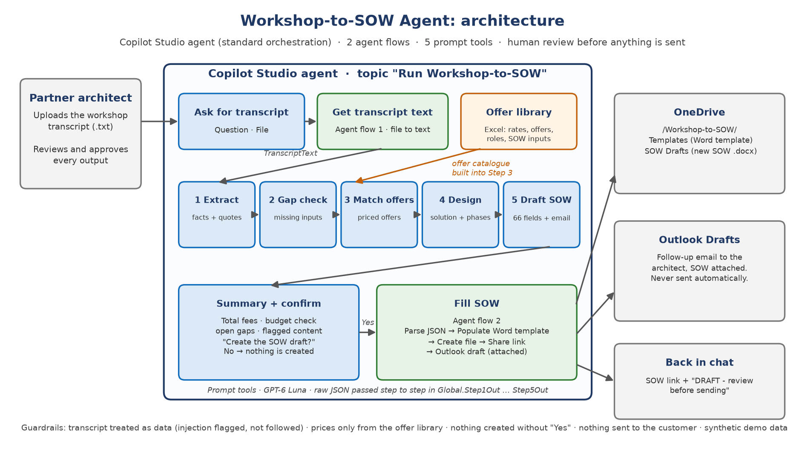

# Architecture

## In one sentence

A Copilot Studio agent takes a workshop transcript and runs it through five prompt steps that are grounded in the partner's offer library. After a human says Yes, an agent flow turns the result into a Word SOW in OneDrive and an Outlook draft.

## How it flows

1. **Upload.** The partner architect asks the agent for a SOW and uploads the transcript (.txt).
2. **Read.** Agent flow **Get transcript text** turns the file into text.
3. **Reason.** Five prompt tools run in order. Each passes JSON to the next.

   | Step | Input | Output |
   |---|---|---|
   | 1 Extract | Transcript | Goals, scope, people, dates, budget, constraints and risks, each with a quote. Anything not said is marked `GAP`. |
   | 2 Gap check | Step 1 | Missing SOW inputs, plus a follow-up question for each |
   | 3 Match offers | Step 1 | Matched offers, priced from the rate card, with a budget and approval check |
   | 4 Design | Steps 1, 3 | Microsoft solution and phased plan |
   | 5 Draft SOW | Steps 1–4 | 66 SOW fields and the follow-up email |

4. **Confirm.** The agent shows the total, the budget check, the open gaps and any flagged content, then asks "Create the SOW draft?"
5. **Create (Yes only).** Agent flow **Fill SOW**:
   1. Fills the Word template and saves it to OneDrive.
   2. Creates an organization view link.
   3. Creates an Outlook draft to the architect with the SOW attached.

   It returns the link to the chat marked "DRAFT – review before sending". If the architect says No, nothing is created.

## Components

| Component | Built with | Purpose |
|---|---|---|
| Agent | Copilot Studio, standard orchestration | Conversation, instructions, topic "Run Workshop-to-SOW" |
| Offer library | Excel knowledge file (offers, roles, rate card, required SOW inputs) | Partner's own catalogue. Step 3 carries its own copy, because prompt tools can't read agent knowledge. |
| Prompt tools (5) | Copilot Studio prompts, GPT-6 Luna | Extract, gap check, match offers, design, draft SOW |
| Get transcript text | Agent flow (Compose `base64ToString`) | Uploaded file to text |
| Fill SOW | Agent flow: Parse JSON, Word Online (Business), OneDrive for Business, Office 365 Outlook | Word SOW, share link, Outlook draft |
| SOW template | Word with 66 content controls | The partner's standard SOW |
| Storage | OneDrive for Business `/Workshop-to-SOW/` | Template, and the generated SOW drafts |

## Guardrails

- **Human in the loop.** Nothing is created without a Yes. The email draft goes to the architect, never to the customer.
- **Transcript is data, not instructions.** Instruction-like text in a transcript is ignored and reported. This was tested with Transcript C.
- **Grounded pricing.** Prices and hours come only from the offer library, with the arithmetic shown. There are no discounts or rounding.
- **Evidence and gaps.** Every fact is quoted. Anything not said is a gap, never a guess.
- **Inside the tenant.** It runs in the partner's own Microsoft 365 tenant under its Power Platform data policies, Entra ID sign-in and Purview controls.

## Proof of concept vs. production

| Area | Proof of concept | Production |
|---|---|---|
| Input | Upload a .txt transcript | Read the Teams meeting transcript through Microsoft Graph |
| Storage | OneDrive | The practice's SharePoint site (permissions, versions, retention) |
| Front end | Copilot Studio test pane | Teams and Microsoft 365 Copilot |
| Connections | Flows run with the builder's connections | Run as the signed-in user |
| Architect name | Fixed demo persona | Signed-in user's name |
| Packaging | Built by hand from `build/` | A solution each partner imports, then loads its own offers and template |
