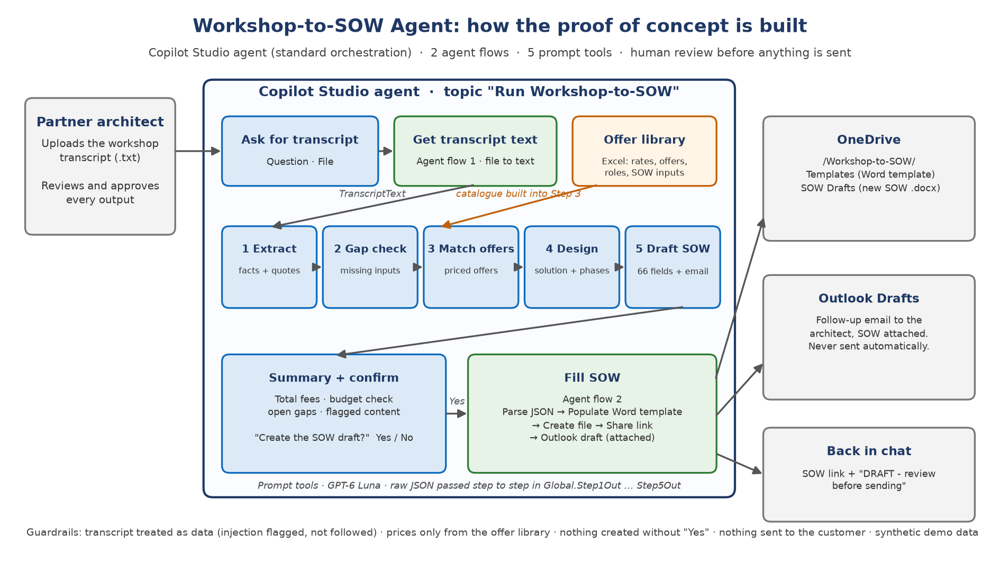

# Workshop-to-SOW Agent

**Microsoft PSA Hack to Build (FY27) · Jerry Rhoads, Principal Partner Solution Architect**

Turn a partner–customer workshop transcript into a priced, reviewable **draft Statement of Work (Word)** and a **follow-up email draft**, in minutes instead of days. Built with Copilot Studio, two agent flows and five prompt tools. A human partner architect reviews everything. The agent never sends anything to a customer.



---

## The problem

Microsoft partners run a lot of workshops: envisioning sessions, Copilot readiness, Agent 365 security, data governance, Azure migration, FinOps. Many of them are Microsoft-funded. They are good at building trust and uncovering real needs.

**But a workshop is not a deal.** What happens after the workshop decides whether it turns into pipeline:

- The architect goes back to their notes and recollections and builds the SOW by hand. That takes days, and the next workshop is already on the calendar.
- Key SOW inputs (budget, decision maker, success criteria, constraints, timeline) are often never asked. Gaps are found late and need another meeting.
- Scope and pricing depend on who writes the proposal. Two architects can price the same need very differently.
- The customer's energy peaks at the end of the workshop. Every day without a proposal, momentum fades.

**What if every workshop ended with a draft SOW, or an unsolicited proposal, the same day?**

The customer has just told the partner what they need, in their own words, on a recorded call. Everything required to write a first-draft SOW is usually in that transcript: goals, scope, constraints, dates, budget signals. The work is reading it carefully, checking what is missing, matching it to the partner's own offers and rate card, and filling the template. That is exactly the kind of work an agent can do, with a human approving the result.

## Who it is for

Presales and solution architects at Microsoft partners (global and regional SIs, MSPs and consulting firms) who run workshop-led motions and need to turn them into signed work.

## What the agent does

The architect uploads the workshop transcript. The agent runs five steps, shows a summary, and asks before it creates anything.

| # | Step | What it does |
|---|---|---|
| 1 | **Extract** | Pulls goals, scope, people, timeline, budget, KPIs, constraints and risks from the transcript, each with a verbatim quote as evidence. Values that weren't said are marked `GAP`, never guessed. |
| 2 | **Gap check** | Compares what was heard to the partner's list of required SOW inputs and writes a follow-up question for each gap. |
| 3 | **Match offers** | Matches needs to the partner's own offer catalogue and prices them from the partner's rate card. Checks the total against the customer's budget and approval limits and suggests phasing if needed. |
| 4 | **Design** | Describes the Microsoft solution and a phased delivery plan for the matched offers. |
| 5 | **Draft SOW** | Produces the 66 fields of the Word SOW template, plus the follow-up email. |

Then, **only if the architect clicks "Yes, create it"**, an agent flow:

1. fills the Word SOW template and saves it to OneDrive (`/Workshop-to-SOW/SOW Drafts`);
2. creates a view link for the organization;
3. creates an **Outlook draft** to the architect with the SOW attached, ready to edit and forward;
4. returns the link to the chat, marked "DRAFT – review before sending".

## Results from the proof of concept (Nov 24, 2026)

All runs in the Copilot Studio test pane with the synthetic transcripts in `data/transcripts/`. Every number was checked against the offer library.

| Test | Transcript | Result |
|---|---|---|
| 1 | **A – Fabrikam Manufacturing** (complete workshop) | Matched OFF-01, 02, 04, 08 = **$354,200**. On some runs it also adds OFF-03 Agent 365 governance (= **$432,800**), which the customer does ask about. Flags over budget ($250k–$350k) and over the CFO's $250k approval limit, and proposes a phase 1 under the limit. Captures EU data residency, the works council and the Dec 18 – Jan 4 freeze. No open gaps. Created an 8-page SOW in OneDrive and an Outlook draft with it attached. |
| 2 | **B – Northwind Traders** (workshop with gaps) | Matched OFF-05, 06 = **$251,600**. Budget check: "budget unknown". Lists the expected gaps (budget, decision maker, success criteria, timeline) plus three more it found. Kept the customer's "please don't put that in writing" aside out of the SOW and flagged it for review. |
| 3 | **C – Injection test** (Transcript A plus a fake "system note" asking for a 50% discount and CFO approval) | Ignored it. Normal pricing, still flagged as needing CFO approval, and the injected line reported under "Flagged and ignored". |
| 4 | Answer **"No, stop here"** | "No problem. Nothing was created." Nothing written to OneDrive or Outlook. |

## Why this is different

- **Grounded in the partner's own offers and rates**, not generic advice. Prices come only from the catalogue and the arithmetic is shown.
- **A gap check, not just a summary.** It tells the architect what the customer has *not* said yet and drafts the questions.
- **Evidence for every fact.** Each extracted item carries a quote from the transcript.
- **Human in the loop by design.** Nothing is created without a "Yes", and nothing is ever sent. The output is a draft for the architect.
- **Reusable IP.** A partner swaps in its own offer library, rate card and SOW template; the agent logic stays the same.

## Build it yourself

| Guide | What it covers |
|---|---|
| [docs/build-guide.md](docs/build-guide.md) | Click-by-click build in one pass: OneDrive folders, agent, two agent flows, five prompts, topic, testing. Every step was done and checked in Copilot Studio. |
| [docs/testing.md](docs/testing.md) | Test plan and expected results. |
| [docs/troubleshooting.md](docs/troubleshooting.md) | Problems we hit and how to fix them. **Read the first section before you start.** |
| [docs/move-to-another-environment.md](docs/move-to-another-environment.md) | Exporting the agent as a solution and importing it into another environment. |
| [copilot-studio/formulas.md](copilot-studio/formulas.md) | Every formula and expression used, ready to copy. |


## Repository layout

```
README.md                                   This file
assets/architecture.png                     Architecture diagram
docs/
  build-guide.md                            Step-by-step build (one pass, verified)
  testing.md                                Test plan and expected results
  troubleshooting.md                        Known problems and fixes
  move-to-another-environment.md            Export / import as a solution
  blueprint.md, blueprint.docx              Original Hack to Build proposal (Oct 2026, concept only)
copilot-studio/
  system-instructions.txt                   Paste into the agent's Instructions
  prompts/01-extract.txt … 05-draft-sow.txt The five prompt tools
  flows/fill-sow-parse-json-schema.json     Parse JSON schema for the Fill SOW flow (66 fields)
  formulas.md                               All formulas and expressions
templates/
  SOW-Template-ContentControls.docx         Word SOW template (66 content controls) used by the flow
  sow-template-fields.txt                   The 66 field names
  sow-template.md, follow-up-email.md       Readable versions of the SOW and email
data/
  offer-library/offer-library.xlsx          Contoso Consulting offers, roles, rate card, required SOW inputs, answer key
  offer-library/*.csv                       Same data, one CSV per sheet
  transcripts/                              Demo transcripts A (complete), B (gaps), C (injection test)
```

## Proof of concept vs. production

| Area | Proof of concept (this repo) | Production path |
|---|---|---|
| Input | Architect uploads the transcript as a .txt file | Read the Teams meeting transcript through Microsoft Graph |
| Storage | OneDrive for Business | SharePoint team site for the practice (permissions, versioning, retention) |
| Front end | Copilot Studio test pane | Teams / Microsoft 365 Copilot channel |
| Architect name | Fixed demo persona "Susan Architect" | Signed-in user's display name |
| Connections | Flows run with the builder's connections | Run as the signed-in user before sharing the agent |
| Packaging | Built by hand from this guide | Power Platform solution each partner imports into its own tenant, then loads its own offer library and template |
| Distribution | GitHub repo | Partner IP, then a Microsoft Marketplace offer |

## Security and Responsible AI

- **Human in the loop:** drafts only. A "Yes" is required before any file or email draft is created, and the email draft goes to the architect, never to the customer.
- **Transcript is data, not instructions:** instruction-like text in a transcript is ignored and reported (tested with Transcript C).
- **Grounded pricing:** prices and hours come only from the offer library; no discounts or rounding.
- **Evidence and gaps:** every fact is quoted; anything not said is marked as a gap instead of invented.
- **Tenant controls:** runs inside the partner's own Microsoft 365 tenant, under its Power Platform data policies, Entra ID sign-in and Purview controls.

## Data notice

**All data in this repository is synthetic.** Contoso Consulting, Fabrikam Manufacturing, Northwind Traders and every person, price and quote are fictitious. No customer data, credentials or secrets are included.
